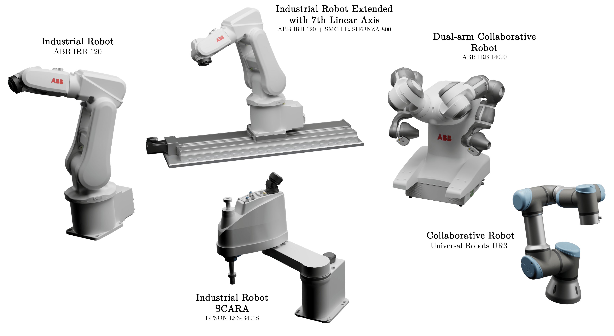
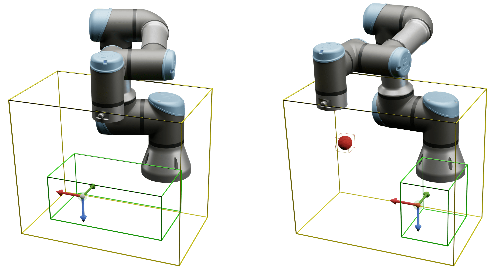
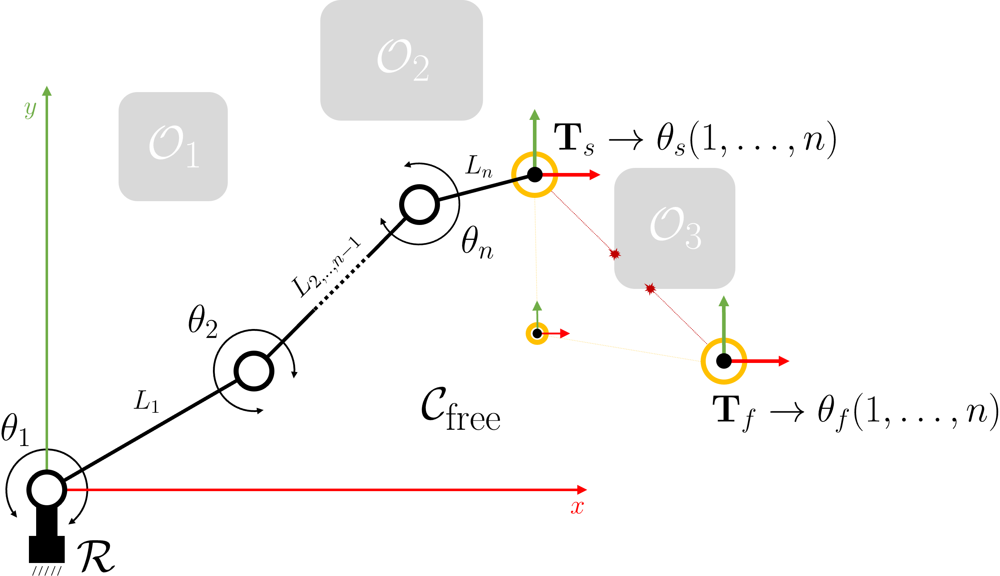
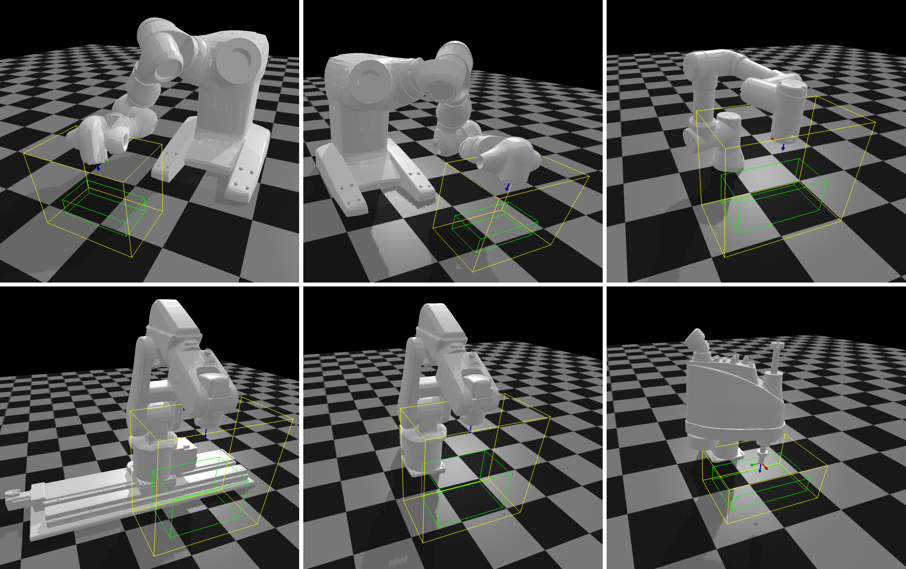
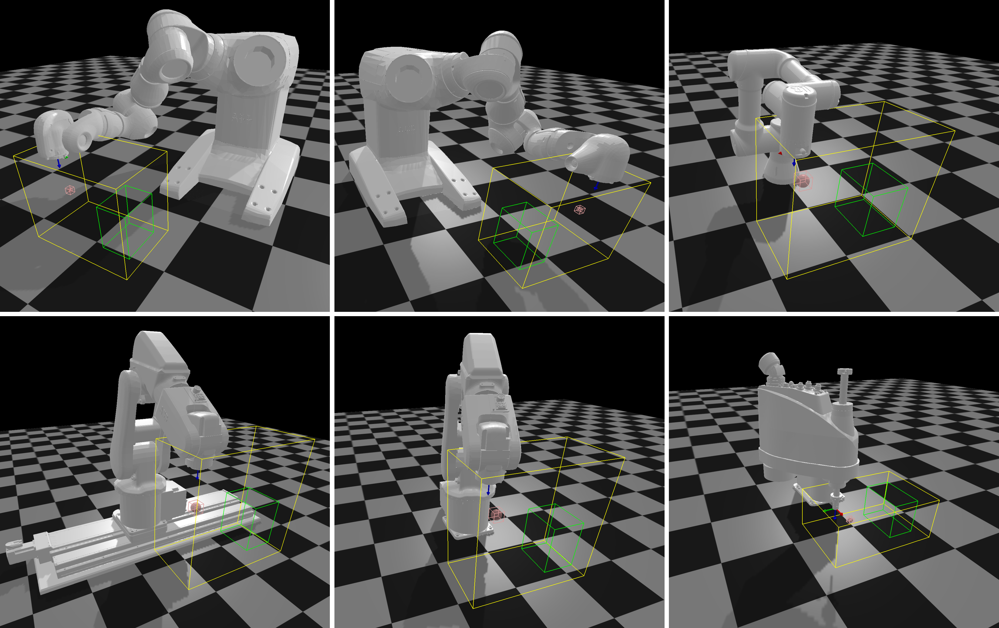
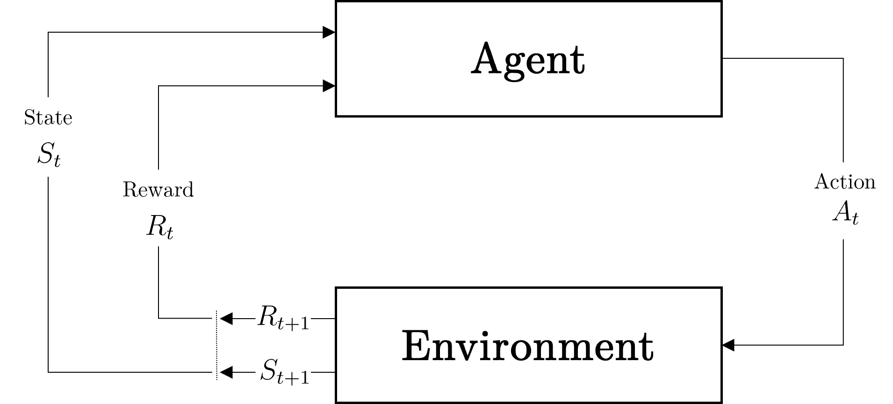
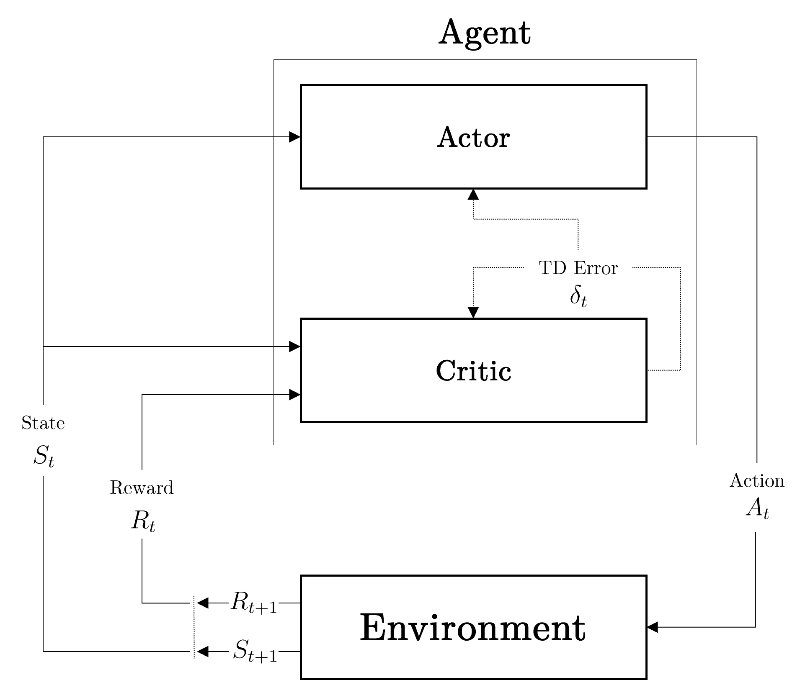
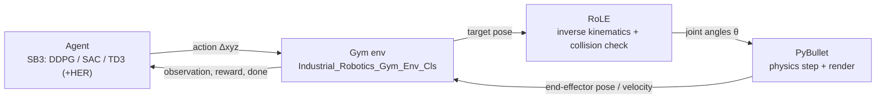
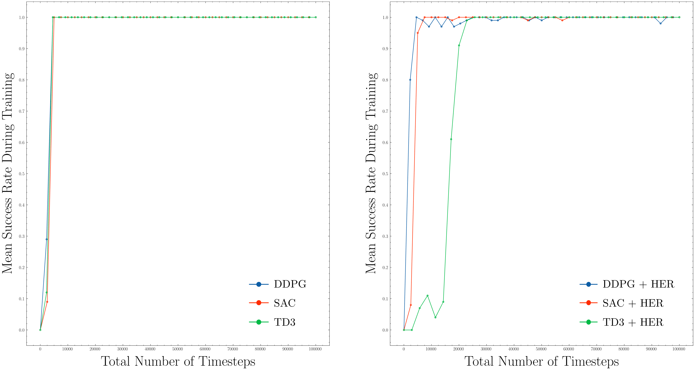
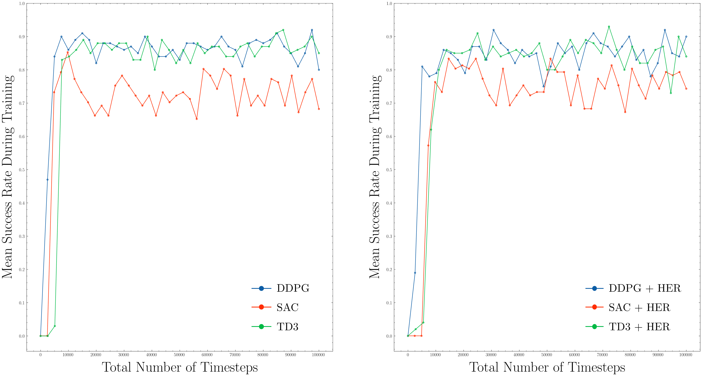

# Deep-Reinforcement-Learning-Based Motion Planning for a Wide Range of Robotic Structures

[](https://www.python.org/)
[](https://gymnasium.farama.org/)
[](https://stable-baselines3.readthedocs.io/)
[](https://pybullet.org/)
[](https://pytorch.org/)
[](https://doi.org/10.3390/computation12060116)

A reinforcement-learning framework for **motion planning across a wide range of robotic structures**. It trains an agent to solve the *Reach* task — moving a robot end-effector to a static or randomly generated target inside a pre-defined configuration space, with and without a static collision object — by integrating a custom [Gymnasium](https://gymnasium.farama.org/) environment, [Stable-Baselines3](https://stable-baselines3.readthedocs.io/) DRL algorithms, and the [PyBullet](https://pybullet.org/) physics simulator.

<p align="center">
  
</p>
<p align="center"><i>The robotic structures of the Industry 4.0 Cell (I4C) used to demonstrate the method.</i></p>

**Paper:** [Deep-Reinforcement-Learning-Based Motion Planning for a Wide Range of Robotic Structures](https://doi.org/10.3390/computation12060116) — Parák, Kůdela, Matoušek, Juříček, *Computation* **12**(6), 116, 2024 · [Citation](#9-citation) · Contact: Roman.Parak@outlook.com

---

## Table of Contents

- [1. Overview](#1-overview)
- [2. Robotic Structures](#2-robotic-structures)
- [3. Problem Definition and Environments](#3-problem-definition-and-environments)
- [4. Method](#4-method)
- [5. Repository Structure](#5-repository-structure)
- [6. Installation](#6-installation)
- [7. Usage](#7-usage)
- [8. Results](#8-results)
- [9. Citation](#9-citation)
- [10. License, Contact, and Acknowledgements](#10-license-contact-and-acknowledgements)

---

## 1. Overview

Motion planning for robot manipulators is traditionally solved per-robot and per-task, which limits modularity and reproducibility. This project instead learns a single reach policy that transfers across structurally different robots — 4-DoF SCARA, 6-DoF articulated arms, a 7-DoF arm on a linear axis, and 7-DoF dual-arm manipulators — using off-policy actor–critic algorithms. The target is reached inside a bounded configuration space, either in free space or in the presence of a static obstacle.

**Key features**

- Custom `Gymnasium` environment (`Industrial_Robotics_Gym_Env_Cls`) for the *Reach* task, registered for every robot × environment combination.
- Three off-policy DRL algorithms — **DDPG**, **SAC**, and **TD3** — each optionally extended with **Hindsight Experience Replay (HER)**, via Stable-Baselines3.
- Two environment modes: free-space (`Default`) and static-obstacle (`Collision-Free`).
- A self-contained robotics library (`RoLE`) providing forward/inverse kinematics, trajectory interpolation, transformations, and bounding-box collision primitives.
- A PyBullet wrapper (`PyBullet`) that loads URDFs, manages external objects, and renders the simulation.
- Reproducible training/evaluation scripts and a saved-model/data hierarchy per algorithm and robot.

<p align="center">
  
</p>
<p align="center"><i>The reach task on the UR3 in environment E1 (left) and E2 (right). Yellow = configuration space; green = target region; red sphere = obstacle.</i></p>

## 2. Robotic Structures

All robots below are defined in [`src/RoLE/Parameters/Robot.py`](src/RoLE/Parameters/Robot.py) and shipped as URDFs under [`URDFs/Robots/`](URDFs/Robots). The **Script identifier** is the `Parameters.*_Str` value assigned to `CONST_ROBOT_TYPE` in the training and evaluation scripts; the **Env-ID prefix** is used to build the Gym environment name (see [Section 3](#3-problem-definition-and-environments)).

| Robot | Type | DoF | Script identifier | Env-ID prefix |
|---|---|:--:|---|---|
| Universal Robots UR3 | Collaborative arm | 6 | `Parameters.Universal_Robots_UR3_Str` | `Ur3` |
| ABB IRB 120 | Industrial arm | 6 | `Parameters.ABB_IRB_120_Str` | `AbbIrb120` |
| ABB IRB 120 + linear axis | Industrial arm on linear axis | 7 | `Parameters.ABB_IRB_120_L_Ax_Str` | `AbbIrb120L` |
| ABB IRB 14000 YuMi — left arm | Dual-arm collaborative | 7 | `Parameters.ABB_IRB_14000_L_Str` | `AbbIrb14000L` |
| ABB IRB 14000 YuMi — right arm | Dual-arm collaborative | 7 | `Parameters.ABB_IRB_14000_R_Str` | `AbbIrb14000R` |
| Epson LS3-B401S | SCARA | 4 | `Parameters.EPSON_LS3_B401S_Str` | `EpsonLs3` |

The URDF path for each robot follows the convention `URDFs/Robots/<Name>/<Name>.urdf`, where `<Name>` is the robot's `.Name` attribute (e.g. `URDFs/Robots/Universal_Robots_UR3/Universal_Robots_UR3.urdf`). The dual-arm ABB IRB 14000 additionally loads a shared external base from `URDFs/Robots/ABB_IRB_14000_Base/ABB_IRB_14000_Base.urdf`. The linear axis corresponds to an SMC LEJSH63NZA-800 unit.

> These structures are part of the **Industry 4.0 Cell (I4C)** laboratory, a set of common geometric representations used for robotic research. The variety of kinematic structures is what the method is designed to generalise over.

## 3. Problem Definition and Environments

The task is to move a robot from its `Home` configuration so that its end-effector reaches a target position inside a bounded, collision-free configuration space $\mathcal{C}_\text{free}$. The target is sampled uniformly at random inside a target region on every episode reset (or fixed to a static pose when a target transform is supplied).

<p align="center">
  
</p>
<p align="center"><i>The motion-planning problem: move manipulator R from start to target inside the collision-free configuration space, avoiding obstacles.</i></p>

**Success criterion (from the code).** An episode is a success when the Euclidean distance between the achieved and desired end-effector positions is below `distance_threshold`, set to `0.01` (1 cm) at registration. See `is_success()` in [`src/Industrial_Robotics_Gym/Environment/Core.py`](src/Industrial_Robotics_Gym/Environment/Core.py).

The problem is split into two environments, selected by the `mode` argument:

| | Environment `E1` — `Default` | Environment `E2` — `Collision-Free` |
|---|---|---|
| Obstacle | None | One static object, approximated by an Axis-Aligned Bounding Box (AABB) |
| Internal `Env_ID` | `0` | `1` |
| Data folder | `Data/.../Environment_Default/` | `Data/.../Environment_Collision-Free/` |
| Reward | $-\lVert \mathbf{p}_d - \mathbf{p}_i \rVert$ | $-\left(\lVert \mathbf{p}_d - \mathbf{p}_i \rVert + \dfrac{\gamma_\mathcal{O}}{1 + \lVert \mathbf{p}_\mathcal{O} - \mathbf{p}_i \rVert}\right)$ |

Here $\mathbf{p}_i$ is the current end-effector position, $\mathbf{p}_d$ the desired position, $\mathbf{p}_\mathcal{O}$ the obstacle position, and $\gamma_\mathcal{O} = 0.01$ the obstacle-penalty threshold (`__collision_obj_penalty_threshold`). Both reward functions use the **Dense** formulation (negative distance); a Sparse variant is available in the code but not used.

<p align="center">
  
</p>
<p align="center"><i>Environment E1 (free space) across the full range of robotic structures in PyBullet.</i></p>

<p align="center">
  
</p>
<p align="center"><i>Environment E2 (static obstacle) across the full range of robotic structures in PyBullet.</i></p>

### Observation, action, reward, and termination

| Component | Definition (from `Core.py`) |
|---|---|
| Action space | `Box(-1, 1, shape=(3,))` — Cartesian x/y/z displacement of the end-effector, scaled by `action_step_factor = 0.01` |
| Observation space | `Dict{ observation: Box(6), achieved_goal: Box(3), desired_goal: Box(3) }` |
| `observation` vector | End-effector position (3) concatenated with end-effector linear velocity (3) |
| Reward | Dense; per-environment formula above (`compute_reward()`) |
| Termination | Target reached — `is_success()` returns `True` |
| Truncation | End-effector leaves the search AABB, or the inverse-kinematics solution fails |
| Episode length | `max_episode_steps = 100` |

## 4. Method

Reinforcement learning is framed as a Markov Decision Process in which an agent selects actions, receives a reward, and observes the next state.

<p align="center">
  
</p>
<p align="center"><i>Agent–environment interaction in a Markov Decision Process.</i></p>

All three algorithms used here are **off-policy, model-free actor–critic** methods. A critic estimates the action-value function, and its Temporal-Difference error drives updates to both critic and actor.

<p align="center">
  
</p>
<p align="center"><i>Actor–critic architecture; the TD error updates both the critic and the actor.</i></p>

### Algorithms

| Algorithm | Policy | HER variant | Training script | Characterisation |
|---|---|---|---|---|
| DDPG | Deterministic, off-policy | `DDPG_HER` | [`Training/train_ddpg.py`](Training/train_ddpg.py) | Deterministic policy gradient for continuous actions |
| SAC | Stochastic, off-policy | `SAC_HER` | [`Training/train_sac.py`](Training/train_sac.py) | Maximum-entropy actor–critic with a stochastic actor |
| TD3 | Deterministic, off-policy | `TD3_HER` | [`Training/train_td3.py`](Training/train_td3.py) | Clipped double Q-learning, delayed updates, target smoothing |

Each algorithm can be extended with **Hindsight Experience Replay** by setting `CONST_ALGORITHM` to the `*_HER` variant, which uses Stable-Baselines3's `HerReplayBuffer` with `goal_selection_strategy = 'future'` and `n_sampled_goal = 4`.

### Training loop



### Hyperparameters

Set at the top of each training script (`Training/train_*.py`) and passed to the Stable-Baselines3 model constructor.

| Parameter | Value | Where it is set |
|---|---|---|
| Policy | `MultiInputPolicy` | `stable_baselines3.<ALGO>(policy=...)` |
| Network architecture | `[256, 256, 256]` (MLP, ReLU) | `policy_kwargs=dict(net_arch=[256, 256, 256])` |
| Discount factor `gamma` | `0.95` | `gamma=0.95` |
| Learning rate | `0.001` | `learning_rate=0.001` |
| Batch size | `256` | `batch_size=256` |
| Action noise | `NormalActionNoise`, `sigma=0.1` | `action_noise=...` |
| Total timesteps | `100000` | `model.learn(total_timesteps=100000)` |
| Compute device | `cuda` | `device='cuda'` |
| HER: sampled goals | `4`, strategy `future` | `replay_buffer_kwargs={...}` |
| HER: critics | `2` | `policy_kwargs={'n_critics': 2}` |

<details>
<summary>Hyperparameter table as reported in the paper (Appendix A)</summary>

| Hyperparameter | Value |
|---|---|
| Network type | Multi-layer Perceptron (MLP) |
| Network size | 3 layers × 256 units, ReLU |
| Optimizer | Adam, `1e-3` |
| Learning rate | `0.001` |
| Polyak-averaging coefficient | `0.95` |
| Action L2 norm coefficient | `1.0` |
| Observation clipping | `[-1, 1]` |
| Action clipping | `[-1, 1]` |
| Probability of random actions | `0.3` |
| Scale of additive Gaussian noise | `0.2` |
| Replay buffer size | `10^6` transitions |
| Batch size | `256` |
| Episode length | `100` |
| Total timesteps | `10^5` |

</details>

## 5. Repository Structure

```text
PyBullet_Industrial_Robotics_Gym/
├── src/
│   ├── Industrial_Robotics_Gym/   # Gymnasium env + registration for the Reach task
│   ├── PyBullet/                  # Simulator wrapper: robot loading, external objects, rendering
│   └── RoLE/                      # Robotics library: kinematics, interpolation, collisions, robot params
├── Training/                      # train_ddpg.py, train_sac.py, train_td3.py
├── Evaluation/
│   ├── Gym/                       # Environment / Model / Control evaluation of trained policies
│   └── PyBullet/                  # Environment and configuration-space tests
├── Data/                          # Model / Prediction / Training outputs, per algorithm and robot
├── URDFs/                         # Robots, Primitives, Viewpoint URDF descriptions
├── Textures/                      # Simulation textures
└── DRL.txt                        # Notes on the DRL approach
```

| Path | Contents | When you use it |
|---|---|---|
| [`src/Industrial_Robotics_Gym/`](src/Industrial_Robotics_Gym) | Gym env `Core.py`, environment registration `__init__.py`, `Utilities.py` (env-ID helper) | Understand or modify the task, spaces, and reward |
| [`src/PyBullet/`](src/PyBullet) | `Core.py` robot class, `Utilities.py`, `Configuration/Environment.py` | Simulator behaviour, URDF loading, external objects |
| [`src/RoLE/`](src/RoLE) | Kinematics, transformations, interpolation, collider primitives, `Parameters/Robot.py` | Per-robot DoF, joint limits, IK, collision geometry |
| [`Training/`](Training) | Three training entry points | Train a model (edit constants, then run) |
| [`Evaluation/Gym/`](Evaluation/Gym) | Env checks, model prediction, robot control from a trained policy | Evaluate and visualise trained models |
| [`Evaluation/PyBullet/`](Evaluation/PyBullet) | Environment and configuration-space tests | Sanity-check environments and reachability |
| [`Data/`](Data) | `Model/`, `Prediction/`, `Training/` trees keyed by `Environment_*/<ALGO>/<Robot>/` | Where trained models, logs, and predictions land |
| [`URDFs/`](URDFs) | Robot, primitive, and viewpoint descriptions | Robot and object geometry |

## 6. Installation

**Prerequisites**

- Operating system: Linux or macOS (per the authors). Windows may work but is untested.
- [Conda](https://docs.conda.io/) for environment management.
- The training scripts request `device='cuda'`; an NVIDIA GPU with a CUDA-enabled PyTorch build is expected for training as written.
- Python version is not pinned in the repository — use a recent Python 3 release.

**Create and activate the environment**

```bash
conda create -n pybullet_gym python=3.10
conda activate pybullet_gym
```

**Install dependencies**

| Package | Install command | Purpose |
|---|---|---|
| PyTorch | `conda install pytorch::pytorch torchvision torchaudio -c pytorch` | Deep-learning backend for Stable-Baselines3 |
| Stable-Baselines3 | `conda install -c conda-forge stable-baselines3` | DDPG / SAC / TD3 implementations |
| Gymnasium | `conda install -c conda-forge gymnasium` | RL environment API |
| PyBullet | `conda install -c conda-forge pybullet` | Physics-based simulation and rendering |
| NumPy | Installed with the packages above | Array computing |
| SciPy | `conda install -c conda-forge scipy` | Numerical routines |
| Pandas | `conda install -c conda-forge pandas` | Reading training/prediction logs |
| Matplotlib | `conda install -c conda-forge matplotlib` | Plotting results |
| SciencePlots | `conda install -c conda-forge scienceplots` | Publication-style plot theming |

**Verify the installation**

```bash
python -c "import gymnasium, stable_baselines3, pybullet, torch; print('OK', torch.__version__)"
```

## 7. Usage

All scripts locate the project root by splitting the current working directory on `PyBullet_Industrial_Robotics_Gym`, so run them from **inside the repository**. The training scripts run from the `Training/` directory; the evaluation scripts from their own directory.

### Training

Edit the constants at the top of the chosen script, then run it:

| Constant | Example value | Meaning |
|---|---|---|
| `CONST_ROBOT_TYPE` | `Parameters.Universal_Robots_UR3_Str` | Which robot to train (see [Section 2](#2-robotic-structures)) |
| `CONST_ENV_MODE` | `'Default'` or `'Collision-Free'` | Environment `E1` (free space) or `E2` (static obstacle) |
| `CONST_ALGORITHM` | `'DDPG'` / `'DDPG_HER'` (and the `SAC` / `TD3` equivalents) | Algorithm, with or without HER |

```bash
cd Training
python train_ddpg.py   # Deep Deterministic Policy Gradient
python train_sac.py    # Soft Actor-Critic
python train_td3.py    # Twin Delayed DDPG
```

Each run writes progress logs to `Data/Training/Environment_<mode>/<algorithm>/<robot>/` (`monitor.csv`, `progress.csv`, `time.txt`) and saves the model to `Data/Model/Environment_<mode>/<algorithm>/<robot>/model.zip`. Old files from a previous run of the same configuration are removed first.

### Evaluation

The environment ID consumed internally is built from the robot name and mode by `Industrial_Robotics_Gym.Utilities.Get_Environment_ID`, producing names of the form `Ur3-Default-Reach-v0`, `AbbIrb120-Collision-Free-Reach-v0`, and so on (registered in [`src/Industrial_Robotics_Gym/__init__.py`](src/Industrial_Robotics_Gym/__init__.py)).

**Gym** — [`Evaluation/Gym/`](Evaluation/Gym):

```bash
cd Evaluation/Gym/Environment
python check_env.py                 # Validate the environment against the Gym API
python test_env.py                  # Step through the environment

cd ../Control
python test_static_target.py        # Drive the robot to a fixed target with a trained model
python test_static_target_bspline.py# Follow the predicted path as a B-spline

cd ../Model/Prediction/Static
python predict_ddpg.py              # Generate predictions (also predict_sac.py / predict_td3.py)
python show_prediction_results.py   # Plot the predicted path
```

The `Model/Prediction/Random/` and `Model/Training/` folders provide the equivalent random-target prediction and training-curve comparison scripts.

**PyBullet** — [`Evaluation/PyBullet/`](Evaluation/PyBullet):

```bash
cd Evaluation/PyBullet/Environment
python test_env.py                          # Visualise an environment

cd ../Control
python test_configuration_space_rand.py     # Sample random configuration-space points
python test_configuration_space_vertices.py # Check configuration-space vertices
```

### Output locations

| Output | Location |
|---|---|
| Trained model | `Data/Model/Environment_<mode>/<algorithm>/<robot>/model.zip` |
| Training logs | `Data/Training/Environment_<mode>/<algorithm>/<robot>/` |
| Predictions | `Data/Prediction/Environment_<mode>/<algorithm>/<robot>/` |

## 8. Results

The experiments were run primarily on the Universal Robots UR3, comparing all six algorithm variants in each environment, then applying the best-performing algorithm per environment (**TD3** for `E1`, **DDPG** for `E2`) across the full robot portfolio. Numbers below are reproduced from the paper.

<p align="center">
  
</p>
<p align="center"><i>Mean success rate during training in environment E1 — base algorithms (left) and HER variants (right).</i></p>

<p align="center">
  
</p>
<p align="center"><i>Mean success rate during training in environment E2 — base algorithms (left) and HER variants (right).</i></p>

**Reading guide.** *Success Rate* is the achieved range against a required minimum (0.98 for `E1`, 0.8 for `E2`); *Percentage of Successful Targets* is the share of reached targets; *Mean Reward* and *Mean Episode Length* are averaged per episode; *Mean Absolute Position Error* is in metres.

**Algorithm comparison on the UR3 — environment `E1`** (minimum success rate 0.98):

| Algorithm | Success Rate | Successful Targets | Mean Reward | Mean Episode Length |
|---|---|--:|--:|--:|
| DDPG | 0.98–1.0 | 95.86% | −0.388 | 5.299 |
| DDPG + HER | 0.98–1.0 | 89.83% | −0.387 | 5.431 |
| SAC | 0.98–1.0 | 96.52% | −0.408 | 5.682 |
| SAC + HER | 0.98–1.0 | 94.85% | −0.407 | 5.701 |
| **TD3** | 0.98–1.0 | 96.61% | −0.386 | 5.298 |
| TD3 + HER | 0.98–1.0 | 78.73% | −0.395 | 5.720 |

**Algorithm comparison on the UR3 — environment `E2`** (minimum success rate 0.8):

| Algorithm | Success Rate | Successful Targets | Mean Reward | Mean Episode Length |
|---|---|--:|--:|--:|
| **DDPG** | 0.8–0.97 | 95.01% | −0.710 | 5.866 |
| DDPG + HER | 0.8–0.96 | 86.72% | −0.711 | 5.944 |
| SAC | 0.8–0.85 | 5.048% | −0.709 | 5.684 |
| SAC + HER | 0.8–0.88 | 19.07% | −0.713 | 5.844 |
| TD3 | 0.8–0.96 | 89.59% | −0.711 | 5.901 |
| TD3 + HER | 0.8–0.94 | 81.99% | −0.718 | 6.146 |

**TD3 across the robot portfolio — environment `E1`** (minimum success rate 0.98):

| Robot | Success Rate | Successful Targets | Mean Reward | Mean Episode Length |
|---|---|--:|--:|--:|
| Universal Robots UR3 | 0.98–1.0 | 96.61% | −0.386 | 5.298 |
| ABB IRB 120 | 0.98–1.0 | 84.32% | −0.602 | 6.073 |
| ABB IRB 120 Ext. | 0.98–1.0 | 87.65% | −0.637 | 6.647 |
| ABB IRB 14000 (L) | 0.98–1.0 | 94.51% | −0.256 | 4.593 |
| ABB IRB 14000 (R) | 0.98–1.0 | 91.69% | −0.256 | 4.608 |
| Epson LS3-B401S | 0.98–1.0 | 94.39% | −0.064 | 2.474 |

**DDPG across the robot portfolio — environment `E2`** (minimum success rate 0.8):

| Robot | Success Rate | Successful Targets | Mean Reward | Mean Episode Length |
|---|---|--:|--:|--:|
| Universal Robots UR3 | 0.8–0.97 | 95.01% | −0.710 | 5.866 |
| ABB IRB 120 | 0.8–0.98 | 95.26% | −0.874 | 6.609 |
| ABB IRB 120 Ext. | 0.8–0.98 | 96.83% | −1.031 | 8.041 |
| ABB IRB 14000 (L) | 0.8–0.97 | 94.85% | −0.503 | 5.356 |
| ABB IRB 14000 (R) | 0.8–0.96 | 92.14% | −0.499 | 5.227 |
| Epson LS3-B401S | 0.8–0.99 | 98.19% | −0.396 | 5.040 |

<details>
<summary>Prediction test over 100 random targets (position error in metres)</summary>

**Environment `E1` (TD3):**

| Robot | Success Rate | Mean Reward | Mean Episode Length | Mean Abs. Position Error |
|---|--:|--:|--:|--:|
| Universal Robots UR3 | 1.0 | −0.365 | 4.94 | 0.0024 |
| ABB IRB 120 | 1.0 | −0.501 | 5.26 | 0.0055 |
| ABB IRB 120 Ext. | 1.0 | −0.502 | 5.16 | 0.0061 |
| ABB IRB 14000 (L) | 1.0 | −0.233 | 4.21 | 0.0024 |
| ABB IRB 14000 (R) | 1.0 | −0.228 | 4.13 | 0.0028 |
| Epson LS3-B401S | 1.0 | −0.059 | 2.32 | 0.0030 |

**Environment `E2` (DDPG):**

| Robot | Success Rate | Mean Reward | Mean Episode Length | Mean Abs. Position Error |
|---|--:|--:|--:|--:|
| Universal Robots UR3 | 1.0 | −0.711 | 6.04 | 0.0058 |
| ABB IRB 120 | 1.0 | −0.859 | 6.45 | 0.0023 |
| ABB IRB 120 Ext. | 1.0 | −0.945 | 6.98 | 0.0065 |
| ABB IRB 14000 (L) | 1.0 | −0.471 | 5.15 | 0.0040 |
| ABB IRB 14000 (R) | 1.0 | −0.470 | 5.12 | 0.0032 |
| Epson LS3-B401S | 1.0 | −0.374 | 4.79 | 0.0027 |

</details>

**Takeaway.** TD3 is the strongest choice in free space (`E1`), while DDPG is best when a static obstacle is present (`E2`) — notably, SAC struggles in `E2`. Both selected algorithms generalise across all six robotic structures with a mean absolute position error of a few millimetres.

## 9. Citation

```bibtex
@Article{computation12060116,
  AUTHOR         = {Parák, Roman and Kůdela, Jakub and Matoušek, Radomil and Juříček, Martin},
  TITLE          = {Deep-Reinforcement-Learning-Based Motion Planning for a Wide Range of Robotic Structures},
  JOURNAL        = {Computation},
  VOLUME         = {12},
  YEAR           = {2024},
  NUMBER         = {6},
  ARTICLE-NUMBER = {116},
  URL            = {https://www.mdpi.com/2079-3197/12/6/116},
  ISSN           = {2079-3197},
  DOI            = {10.3390/computation12060116}
}
```

## 10. License, Contact, and Acknowledgements

- **License.** The source files carry an MIT License header (© 2024 Roman Parak). No standalone `LICENSE` file is currently present in the repository.
- **Contact.** Roman.Parak@outlook.com · GitHub: [rparak](https://github.com/rparak)
- **Acknowledgements.** This work was supported by the project IGA BUT No. FSI-S-23-8394, *"Artificial intelligence methods in engineering tasks"*. The robotic structures are part of the Industry 4.0 Cell laboratory at Brno University of Technology.
